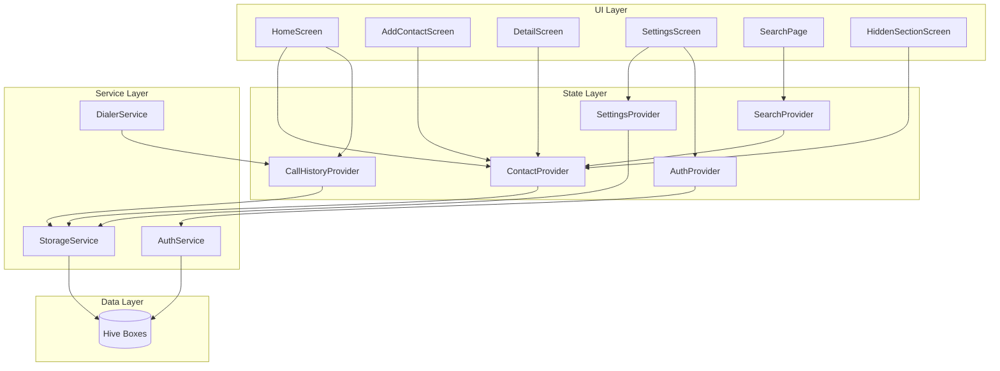

# Design Document: Masked Contact Dialer

## Overview

Masked Contact Dialer is a Flutter/Dart Android application that provides a privacy-focused local contact management system. Users create contact entries with separate display labels (Display_Name, Display_Number) and actual destination numbers (Real_Number). The UI only shows display information, while calls are routed to the real number via Android Intent APIs. All data is stored locally using Hive with no network dependency. The app supports PIN and biometric authentication, contact categorization, favorites, call history logging, and a hidden contacts section.

### Key Design Decisions

1. **Riverpod for state management** — chosen over Provider for its compile-safe dependency injection, better testability, and auto-dispose capabilities. Riverpod providers are pure functions that can be unit-tested without widget trees.
2. **Hive for local storage** — a lightweight, fast key-value store with Dart-native type adapters. No SQL overhead, and it works fully offline with no setup.
3. **Repository pattern** — services (StorageService, DialerService, AuthService) are abstracted behind interfaces, making them mockable for testing and swappable for future changes.
4. **Separate display vs. real number at the model level** — the ContactModel always carries both, but UI widgets only bind to display fields. The real number is only accessed by the DialerService and the Detail_Screen.

## Architecture

The app follows a layered architecture with clear separation between UI, state management, services, and data.



### Layer Responsibilities

- **UI Layer**: Stateless/Stateful widgets that consume Riverpod providers. No business logic. Screens delegate all actions to providers.
- **State Layer**: Riverpod providers that hold application state, orchestrate service calls, and expose reactive state to the UI. Providers are the single source of truth.
- **Service Layer**: Platform-agnostic business logic and I/O operations. StorageService wraps Hive CRUD. DialerService wraps url_launcher/Android Intent calls. AuthService wraps local_auth and PIN verification.
- **Data Layer**: Hive boxes storing ContactModel, CallHistoryEntry, user preferences, and categories.

## Components and Interfaces

### Models

#### ContactModel
```dart
@HiveType(typeId: 0)
class ContactModel extends HiveObject {
  @HiveField(0) String id;           // UUID
  @HiveField(1) String displayName;
  @HiveField(2) String displayNumber;
  @HiveField(3) String realNumber;
  @HiveField(4) String? imagePath;
  @HiveField(5) String? notes;
  @HiveField(6) List<String> tags;
  @HiveField(7) String? category;
  @HiveField(8) bool isFavorite;
  @HiveField(9) bool isHidden;
  @HiveField(10) bool isPinned;
  @HiveField(11) DateTime createdAt;
  @HiveField(12) DateTime updatedAt;
}
```

#### CallHistoryEntry
```dart
@HiveType(typeId: 1)
class CallHistoryEntry extends HiveObject {
  @HiveField(0) String id;
  @HiveField(1) String contactId;
  @HiveField(2) DateTime timestamp;
  @HiveField(3) String callMode; // 'ACTION_DIAL' or 'ACTION_CALL'
}
```

#### CategoryModel
```dart
@HiveType(typeId: 2)
class CategoryModel extends HiveObject {
  @HiveField(0) String name;
  @HiveField(1) DateTime createdAt;
}
```

### Services

#### StorageService Interface
```dart
abstract class StorageService {
  // Contacts
  Future<void> addContact(ContactModel contact);
  Future<void> updateContact(ContactModel contact);
  Future<void> deleteContact(String id);
  ContactModel? getContact(String id);
  List<ContactModel> getAllContacts();
  List<ContactModel> getVisibleContacts();   // excludes hidden
  List<ContactModel> getHiddenContacts();
  List<ContactModel> getFavoriteContacts();
  List<ContactModel> getContactsByCategory(String category);

  // Categories
  Future<void> addCategory(String name);
  Future<void> deleteCategory(String name);
  List<String> getAllCategories();

  // Call History
  Future<void> logCall(CallHistoryEntry entry);
  List<CallHistoryEntry> getCallHistory();
  Future<void> clearCallHistory();
  int getCallCount(String contactId);

  // Preferences
  Future<void> saveSetting(String key, dynamic value);
  T? getSetting<T>(String key);
}
```

#### DialerService Interface
```dart
abstract class DialerService {
  /// Launches Android dialer with number pre-filled (ACTION_DIAL)
  Future<bool> dialNumber(String phoneNumber);

  /// Directly places a call (ACTION_CALL), requires CALL_PHONE permission
  Future<bool> callNumber(String phoneNumber);

  /// Checks if CALL_PHONE permission is granted
  Future<bool> hasCallPermission();

  /// Requests CALL_PHONE permission
  Future<bool> requestCallPermission();
}
```

#### AuthService Interface
```dart
abstract class AuthService {
  /// Check if app lock is enabled
  bool isAppLockEnabled();

  /// Check if biometric is available on device
  Future<bool> isBiometricAvailable();

  /// Verify PIN
  bool verifyPin(String pin);

  /// Set or update PIN
  Future<void> setPin(String pin);

  /// Verify hidden section PIN
  bool verifyHiddenPin(String pin);

  /// Set or update hidden section PIN
  Future<void> setHiddenPin(String pin);

  /// Authenticate with biometrics
  Future<bool> authenticateWithBiometrics();

  /// Check if biometric unlock is enabled in settings
  bool isBiometricEnabled();
}
```

### Riverpod Providers

```dart
// Contact state
final contactProvider = StateNotifierProvider<ContactNotifier, List<ContactModel>>(
  (ref) => ContactNotifier(ref.read(storageServiceProvider)),
);

// Auth state
final authProvider = StateNotifierProvider<AuthNotifier, AuthState>(
  (ref) => AuthNotifier(ref.read(authServiceProvider)),
);

// Call history state
final callHistoryProvider = StateNotifierProvider<CallHistoryNotifier, List<CallHistoryEntry>>(
  (ref) => CallHistoryNotifier(ref.read(storageServiceProvider)),
);

// Search/filter state
final searchQueryProvider = StateProvider<String>((ref) => '');
final categoryFilterProvider = StateProvider<String?>((ref) => null);
final showFavoritesOnlyProvider = StateProvider<bool>((ref) => false);

// Filtered contacts (derived)
final filteredContactsProvider = Provider<List<ContactModel>>((ref) {
  final contacts = ref.watch(contactProvider);
  final query = ref.watch(searchQueryProvider);
  final category = ref.watch(categoryFilterProvider);
  final favoritesOnly = ref.watch(showFavoritesOnlyProvider);
  // Filter and sort logic applied here
});
```

### Widgets

| Widget | Purpose |
|--------|---------|
| `ContactTile` | Displays a single contact in the list with Display_Name, Display_Number, avatar, favorite star, and call button. Never shows Real_Number. |
| `CustomButton` | Reusable Material 3 styled button with ripple and elevation. |
| `SearchBar` | Text input with real-time filtering, debounced to avoid excessive rebuilds. |
| `GradientAvatar` | Generates a colored avatar from the contact's display name when no image is set. |
| `ConfirmationDialog` | Reusable dialog for delete confirmations, call confirmations, and clear history. |
| `PinEntryWidget` | Numeric keypad for PIN input with dot indicators. |

## Data Models

### Hive Box Layout

| Box Name | Type ID | Contents | Key Strategy |
|----------|---------|----------|--------------|
| `contacts` | 0 | `ContactModel` instances | UUID string key |
| `call_history` | 1 | `CallHistoryEntry` instances | UUID string key |
| `categories` | 2 | `CategoryModel` instances | Category name as key |
| `settings` | — | Dynamic key-value pairs | String key (e.g., `app_lock_enabled`, `pin_hash`, `hidden_pin_hash`, `biometric_enabled`, `call_mode`, `call_confirm_enabled`, `export_logs_enabled`) |

### ContactModel Field Constraints

| Field | Type | Required | Default | Constraints |
|-------|------|----------|---------|-------------|
| `id` | String | Yes | UUID v4 | Unique identifier |
| `displayName` | String | Yes | — | Non-empty, trimmed |
| `displayNumber` | String | Yes | `realNumber` | Falls back to realNumber if empty |
| `realNumber` | String | Yes | — | Non-empty, valid phone format |
| `imagePath` | String? | No | null | Local file path |
| `notes` | String? | No | null | Free text |
| `tags` | List\<String\> | No | [] | User-defined labels |
| `category` | String? | No | null | Must match existing category or null |
| `isFavorite` | bool | No | false | — |
| `isHidden` | bool | No | false | — |
| `isPinned` | bool | No | false | — |
| `createdAt` | DateTime | Yes | now | Set on creation |
| `updatedAt` | DateTime | Yes | now | Updated on every save |

### PIN Storage

PINs are stored as SHA-256 hashes in the `settings` Hive box. The app never stores plaintext PINs. Verification compares the hash of user input against the stored hash.

### Contact Sorting Rules

The Contact_List on the Home_Screen is sorted in this priority order:
1. Pinned contacts first
2. Favorited contacts second
3. Remaining contacts sorted alphabetically by Display_Name
4. Hidden contacts are excluded from the main list entirely

## Correctness Properties

*A property is a characteristic or behavior that should hold true across all valid executions of a system — essentially, a formal statement about what the system should do. Properties serve as the bridge between human-readable specifications and machine-verifiable correctness guarantees.*

### Property 1: Contact persistence round-trip

*For any* valid ContactModel with non-empty displayName, non-empty realNumber, arbitrary displayNumber, notes, tags, category, favorite status, pinned status, and hidden status, saving the contact via StorageService and then retrieving it by ID should produce a ContactModel with all fields equal to the original.

**Validates: Requirements 1.1, 1.6, 3.1, 9.3, 13.1, 13.2**

### Property 2: Required field validation rejects invalid contacts

*For any* contact submission where displayName is empty/whitespace OR realNumber is empty/whitespace, the validation function should return a failure result and the contact should not be persisted.

**Validates: Requirements 1.2, 1.3**

### Property 3: Empty display number defaults to real number

*For any* valid contact submission where displayNumber is empty, the persisted ContactModel should have displayNumber equal to realNumber.

**Validates: Requirements 1.4**

### Property 4: Contact update round-trip

*For any* existing ContactModel and any valid set of field modifications (changed displayName, displayNumber, realNumber, notes, tags, category, favorite, pinned), updating the contact via StorageService and retrieving it should produce a ContactModel reflecting all modifications while preserving the original ID and createdAt.

**Validates: Requirements 2.1**

### Property 5: Contact deletion removes from storage

*For any* set of persisted contacts and any contact selected for deletion, after deletion the contact should not be retrievable by ID and should not appear in getAllContacts().

**Validates: Requirements 2.2**

### Property 6: Category filter returns exactly matching contacts

*For any* set of contacts with various categories and any selected category filter, getContactsByCategory should return exactly those contacts whose category matches the filter — no more, no fewer.

**Validates: Requirements 3.2, 3.3**

### Property 7: Call routing always uses real number

*For any* ContactModel where displayNumber differs from realNumber, when the DialerService initiates a call for that contact, the phone number passed to the Android Intent API should be the realNumber, never the displayNumber.

**Validates: Requirements 4.3**

### Property 8: Real number never exposed in contact list

*For any* set of contacts where at least one contact has realNumber different from displayNumber, the data exposed to the ContactTile widget (the contact list view) should never include the realNumber field — only displayName, displayNumber, and imagePath.

**Validates: Requirements 6.2**

### Property 9: Contact list sorting order

*For any* list of visible (non-hidden) contacts with mixed pinned, favorite, and alphabetical ordering, the sorted contact list should satisfy: all pinned contacts appear before non-pinned contacts, within each pinned/non-pinned group all favorites appear before non-favorites, and within each subgroup contacts are sorted alphabetically by displayName (case-insensitive).

**Validates: Requirements 6.3, 12.3, 13.4**

### Property 10: Search filter returns correct matches

*For any* set of contacts and any non-empty search query string, the filtered results should contain exactly those contacts where displayName, displayNumber, or any tag contains the query as a case-insensitive substring.

**Validates: Requirements 12.1**

### Property 11: Favorites filter returns only favorites

*For any* set of contacts with mixed favorite status, applying the favorites-only filter should return exactly those contacts where isFavorite is true.

**Validates: Requirements 12.2**

### Property 12: Incorrect PIN is always rejected

*For any* stored PIN hash and any input PIN that differs from the original PIN, verifyPin (and verifyHiddenPin) should return false.

**Validates: Requirements 10.2, 15.3**

### Property 13: Call history logging round-trip

*For any* call initiated through the DialerService with a valid contactId and callMode, a corresponding CallHistoryEntry should be persisted with matching contactId, callMode, and a timestamp within a reasonable window of the call initiation time.

**Validates: Requirements 14.1**

### Property 14: Call history chronological sort

*For any* set of CallHistoryEntry records with various timestamps, getCallHistory() should return them in descending timestamp order (most recent first).

**Validates: Requirements 14.2**

### Property 15: Call frequency count invariant

*For any* contact and any set of call history entries, getCallCount(contactId) should return exactly the number of CallHistoryEntry records whose contactId matches.

**Validates: Requirements 14.4**

### Property 16: Hide/unhide round-trip

*For any* visible contact, hiding it should remove it from getVisibleContacts() and add it to getHiddenContacts(). Subsequently unhiding it should restore it to getVisibleContacts() and remove it from getHiddenContacts(), with all other fields unchanged.

**Validates: Requirements 15.1, 15.5**

## Error Handling

### Validation Errors
- **Empty required fields**: Display inline validation errors on the Add_Contact_Screen for missing displayName or realNumber. Do not submit the form.
- **Invalid phone format**: Display a validation error if realNumber contains non-numeric characters (excluding `+`, `-`, spaces, and parentheses).
- **Duplicate contact**: No uniqueness constraint — users may create contacts with identical display names or numbers.

### Authentication Errors
- **Incorrect PIN**: Show error message, remain on auth screen. No lockout mechanism (user can retry indefinitely).
- **Biometric failure**: Show error, fall back to PIN entry automatically.
- **Biometric unavailable**: Hide biometric option in settings. If previously enabled and hardware becomes unavailable, fall back to PIN.

### Storage Errors
- **Hive box open failure**: Show a fatal error screen with a retry option. Log the error.
- **Disk full**: Catch write exceptions, display a user-friendly message indicating storage is full.
- **Corrupted data**: If a ContactModel fails to deserialize, skip it in the list and log a warning. Do not crash.

### Dialer Errors
- **url_launcher failure**: If `launchUrl` returns false or throws, display a snackbar with "Unable to open dialer" message.
- **Permission denied (ACTION_CALL)**: Fall back to ACTION_DIAL mode as specified in Requirement 5.3.
- **No dialer app**: Display an error message if no app can handle the dial/call intent.

### Image Errors
- **Image file missing**: If a contact's imagePath points to a deleted file, fall back to GradientAvatar. Do not crash.
- **Image too large**: No explicit size limit, but use image compression when saving to avoid excessive storage use.

## Testing Strategy

### Unit Tests
Unit tests cover specific examples, edge cases, and error conditions using Flutter's built-in test framework (`flutter_test`).

**Focus areas:**
- ContactModel validation logic (required fields, default values, phone format)
- StorageService CRUD operations with a real Hive instance (in-memory for tests)
- AuthService PIN hashing and verification
- DialerService call routing logic (mocked url_launcher)
- Contact sorting and filtering logic
- Call history logging and retrieval
- Category management

### Property-Based Tests
Property-based tests verify universal properties across many generated inputs. Use the `dart_quickcheck` or `glados` package for Dart property-based testing.

**Configuration:**
- Minimum 100 iterations per property test
- Each test tagged with: **Feature: masked-contact-dialer, Property {number}: {title}**

**Properties to implement:**
- Property 1: Contact persistence round-trip
- Property 2: Required field validation rejects invalid contacts
- Property 3: Empty display number defaults to real number
- Property 4: Contact update round-trip
- Property 5: Contact deletion removes from storage
- Property 6: Category filter returns exactly matching contacts
- Property 7: Call routing always uses real number
- Property 8: Real number never exposed in contact list
- Property 9: Contact list sorting order
- Property 10: Search filter returns correct matches
- Property 11: Favorites filter returns only favorites
- Property 12: Incorrect PIN is always rejected
- Property 13: Call history logging round-trip
- Property 14: Call history chronological sort
- Property 15: Call frequency count invariant
- Property 16: Hide/unhide round-trip

### Widget Tests
Widget tests verify UI rendering and interaction using `flutter_test` with `WidgetTester`.

**Focus areas:**
- HomeScreen renders contact list with display fields only
- AddContactScreen form validation and submission
- DetailScreen shows all fields including realNumber
- SettingsScreen conditional rendering (biometric option visibility)
- Confirmation dialogs for delete and clear history
- FAB presence on HomeScreen
- GradientAvatar rendering for contacts without images
- Search bar filtering interaction
- PIN entry widget behavior

### Integration Tests
Integration tests verify end-to-end flows using `integration_test` package.

**Focus areas:**
- Full contact creation → display → call flow
- App lock → PIN entry → home screen flow
- Hidden section → PIN → view hidden contacts flow
- Search → filter → call flow
- Call history logging during calls
